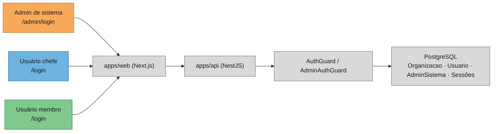
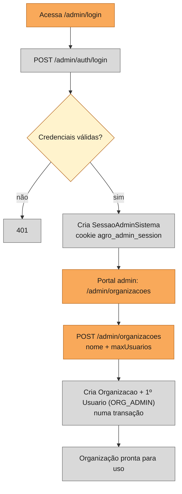
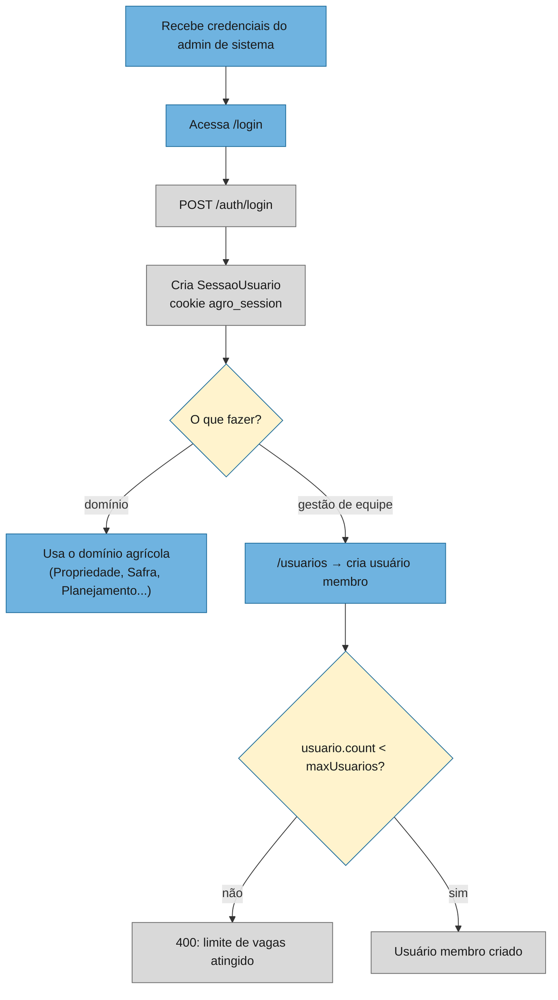
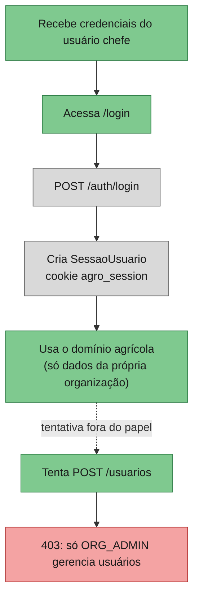

# Fluxos do sistema

Documento vivo — atualize os diagramas sempre que um fluxo de autenticação ou de domínio mudar. Cores por
papel: **laranja** = admin de sistema, **azul** = usuário chefe (ORG_ADMIN), **verde** = usuário membro
(ORG_MEMBER), **cinza** = sistema (API/banco).

> Status: reflete o design em `docs/superpowers/specs/2026-10-14-autenticacao-multiempresa-design.md`,
> ainda não implementado. Atualize este arquivo junto com o código quando a implementação acontecer.

## Visão geral

## Jornada: Admin de sistema

## Jornada: Usuário chefe (ORG_ADMIN)

## Jornada: Usuário membro (ORG_MEMBER)

